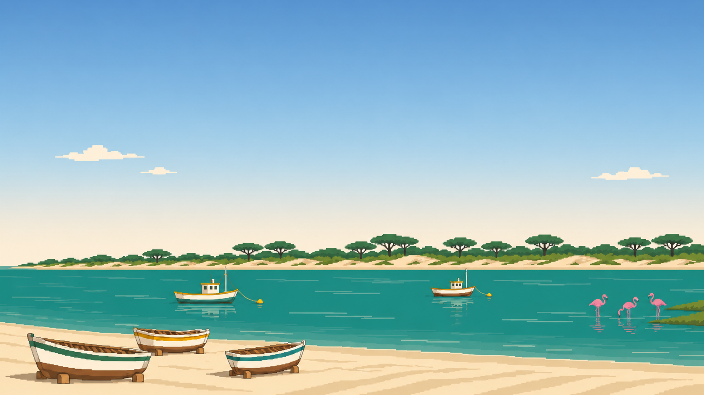

# Sanlúcar Light

A light [Omarchy](https://omarchy.org/) theme inspired by the view from Sanlúcar de Barrameda, Spain: beach sand and whitewashed walls, the pine-covered dunes of Doñana across the river, the green-brown Guadalquivir, manzanilla gold and Doñana's flamingos.



## Install

```bash
omarchy theme install https://github.com/almaro90/omarchy-sanlucar-light-theme
omarchy theme set sanlucar-light
```

For the sunset version, see [Sanlúcar Dark](https://github.com/almaro90/omarchy-sanlucar-dark-theme).

## Palette

| Role | Color | Inspiration |
| --- | --- | --- |
| Background | `#FAF4E6` | Beach sand, whitewash |
| Foreground | `#1E2B25` | Pine shadow |
| Accent | `#2F6B4F` | Doñana pines |
| Red | `#B8432F` | Sunset over the river mouth |
| Orange | `#C96F2A` | Dusk |
| Yellow | `#A88412` | Manzanilla |
| Green | `#5B7F2B` | Marshland |
| Cyan | `#2A7F7A` | Guadalquivir |
| Blue | `#2F6497` | Atlantic |
| Magenta | `#B9527A` | Flamingos |
| Brown | `#7A5430` | Sherry casks |

Window borders run from Doñana green to Guadalquivir teal. Icons use Yaru-sage.

## Backgrounds

The default is a pixel-art view of the river mouth. The others are photos from Wikimedia Commons, released under CC BY-SA. Sources and licenses are listed in [CREDITS.txt](CREDITS.txt).
